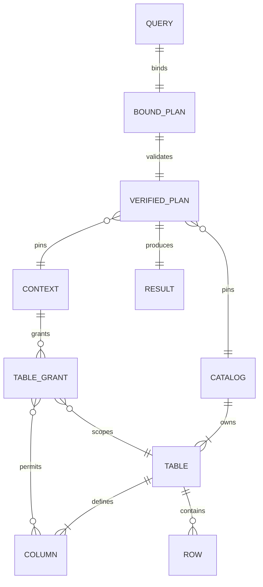

# API, data and protocol contract

Version 1.0. This is the intended complete product contract. Initial prototype/seed coverage must be stated separately in IMPLEMENTATION_STATUS.md. No network endpoint is implied.

## CLI (target interface)
`rillscope run --catalog PATH --context PATH --query PATH [--format json|sql] [--optimize on|off]`
`rillscope explain --catalog PATH --context PATH --query PATH [--format json|sql]`
`rillscope --version`

`--query -` reads bounded stdin. Catalog/context are trusted operator paths. Format defaults json; optimize defaults on. One query per invocation. Unknown/duplicate flags reject. JSON input must be valid UTF-8, no duplicate object keys, no unknown fields, finite numeric literals only. Source query is <=64 KiB. No query interpolation into shell commands. Embedding adapter exposes only query and output choice, never tenant/catalog/context/paths or resource-limit overrides.

CLI success exit 0; invalid input/bind/type/unsupported/forbidden exit 2; resource/output limit exit 3; cancellation exit 4; catalog/operator configuration exit 5; verifier/internal execution failure exit 6. Hard OS termination may produce no envelope and is a distinct process failure. There are no retry-after headers, HTTP status codes or rate limits because no HTTP service exists. A future service requires a separate ADR/auth/threat revision rather than relabeling CLI flags secure remote parameters.

## Query JSON v1
The sole top-level input fields are `version` (integer 1) and `plan`. A plan is a tagged closed union:

|op|required fields|meaning|
|---|---|---|
|scan|table, alias|Unresolved table request, lowered to a trusted PolicyScan after authorization|
|filter|input, predicate|Keep rows whose typed Boolean predicate is TRUE|
|project|input, columns|columns is a nonempty list of unique {name,expr}; output names reset qualification|
|join|left, right, on|INNER equijoin; on is a nonempty list of {left,right} column expressions; duplicate rows preserved|
|aggregate|input, keys, aggregates|keys list of {name,expr}; aggregates list of named count_all/count/sum; combined output names unique|
|sort|input, keys|keys list of {expr,direction,nulls}; direction asc/desc; nulls first/last|
|limit|input, count|Nonnegative integer <=10000; semantic row limit|

Expression closed union: `{"col":"alias.name"}` or `{"lit":VALUE}` or `{"lit":null,"type":"i64|bool|text"}` or unary `{"op":"not|is_null","expr":EXPR}` or binary `{"op":"eq|ne|lt|le|gt|ge|and|or|add|sub","left":EXPR,"right":EXPR}`. Identifier is ASCII `[A-Za-z_][A-Za-z0-9_]*` up to64 bytes; qualified names contain one dot. No user-defined function or wildcard expression in JSON. Non-null literals infer exact type; booleans are not integers; text <=4096 UTF-8 bytes; integer within signed64 range. Null literal requires explicit type. All child objects are closed unions and unknown keys reject.

Aggregate spec: `{"name":"n","kind":"count_all"}` or `{"name":"n","kind":"count","expr":EXPR}` or `{"name":"total","kind":"sum","expr":INT64_EXPR}`. Empty key list means scalar aggregation. At least one key or aggregate is required. Sort expressions may reference only current output columns, preventing hidden input access after projection. Join keys must each be a direct column from the respective input in v1.

Example:
```json
{"version":1,"plan":{"op":"project","input":{"op":"filter","input":{"op":"scan","table":"sales","alias":"s"},"predicate":{"op":"gt","left":{"col":"s.amount"},"right":{"lit":10}}},"columns":[{"name":"id","expr":{"col":"s.id"}},{"name":"amount","expr":{"col":"s.amount"}}]}}
```

## Restricted SQL v1
One SELECT statement, optional final semicolon; named table aliases; selected columns and documented expressions; optional one INNER JOIN with conjunctive column equalities; WHERE; GROUP BY; COUNT(*)/COUNT(expr)/SUM(Int64); ORDER BY output column/alias with ASC/DESC and NULLS FIRST/LAST; literal nonnegative LIMIT. Qualified `*`, bare `*`, CTEs, subqueries, set operations, DISTINCT, windows, outer/cross/lateral joins, HAVING, casts, decimal/float/date types, quoted identifiers, arbitrary functions, placeholders and multiple statements are unsupported in v1. SQL parser acceptance is not product support: lowering is an explicit allowlist and rejects every unmatched AST variant. Parser recurrence limit must be configured and preflight nesting bounded. SQL NULL comparisons follow 3VL; use IS NULL. SQL aliases are normalized consistently, then use stable bound column identities.

## Catalog JSON v1 (trusted input, still validated)
```json
{"version":1,"snapshot":"demo-v1","tables":{"sales":{"columns":[{"name":"tenant","type":"text","nullable":false},{"name":"id","type":"i64","nullable":false},{"name":"amount","type":"i64","nullable":true}],"rows":[["alpha",1,20],["beta",2,999],["alpha",3,null]]}}}
```
Schema is authoritative; do not infer from rows. Column names are unique per table. Row length must equal schema length; types exact; null allowed only when nullable. Snapshot is a bounded operator-selected label and content digest is computed separately. No catalog mutation or on-disk indexes. Any compiled handle is bound to the immutable loaded snapshot object/digest, not merely a client-controlled label. Max file bytes/row count/string size are validated before operator execution; untrusted arbitrary catalog upload is not supported.

## Trusted context JSON v1
```json
{"version":1,"policy_revision":"demo-r1","tenant":"alpha","tables":{"sales":{"tenant_column":"tenant","columns":["id","amount"]}}}
```
Only these fields. Tenant is a nonempty text <=128 bytes; revision <=128 bytes. Table grant names and columns must exist and be unique. Tenant column must be non-null text. It is used internally even if not visible; it becomes user-visible only if explicitly allowed. Omitted table means denied. Client-supplied plans cannot redefine aliases into grants; scan occurrence identity is created during binding. Context content and catalog identity are pinned before compilation. No expiry clock, token signature or cryptographic revocation promise; each invocation receives fresh host configuration. A long-lived host must explicitly cancel old queries when replacing context if immediate revocation is required.

## Successful output
```json
{"version":1,"status":"ok","schema":[{"name":"id","type":"i64","nullable":false},{"name":"amount","type":"i64","nullable":true}],"rows":[[1,20]],"metrics":{"work_units":7,"peak_reserved_bytes":0},"implementation":"rust"}
```
Numbers above are ILLUSTRATIVE SCHEMA VALUES, not a measured run. Actual metrics are computed. Output integers are JSON integers; clients must not silently round values above 2^53 (use a lossless decoder). `implementation` explicitly distinguishes rust from python-reference; only Rust output is product acceptance. Output metrics must not include hidden values or unfiltered table counts for untrusted consumers. Trusted benchmark instrumentation is a separate output file with an explicit synthetic-only mode. Example result demonstrates scope but does not establish an actual run.

## Error output
```json
{"version":1,"status":"error","error":{"code":"E_FORBIDDEN","phase":"bind","message":"column is not available in this scope"},"implementation":"rust"}
```
Closed error codes: E_INPUT, E_UNSUPPORTED, E_BIND, E_TYPE, E_FORBIDDEN, E_CATALOG, E_CONTEXT, E_PLAN, E_LIMIT, E_BUDGET, E_OUTPUT_LIMIT, E_CANCELLED, E_OVERFLOW, E_INTERNAL. Message templates never interpolate data/literal values or trusted paths. No stack trace by default. Errors are not cached. One terminal JSON object, never rows followed by success and later error.

## Resource state
Budget state: max_work, consumed_work, max_reserved_bytes, currently_reserved, peak_reserved, cancellation flag/deadline. `charge(n)` and `reserve(n)` check overflow and limits before work/allocation; `release(n)` must not underflow and should be RAII. Work increments are deterministic documented abstract operations, not elapsed CPU. Count output bytes before publication. Each operator checks cancellation at entry and each batch/1024 inner steps. No exact RSS limit is implied.

## Data model / relationships

These are in-memory relationships, not a hidden relational server or migration framework. All public fixtures are self-authored synthetic data under the repository license. No real employee/customer data, benchmark license assumptions or paid API data.
