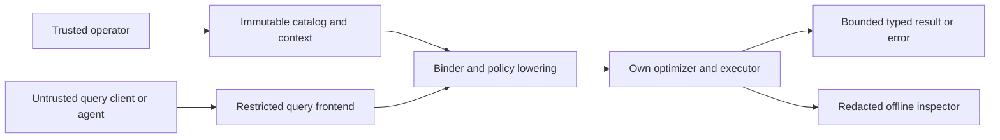
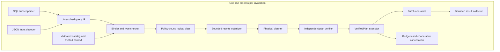
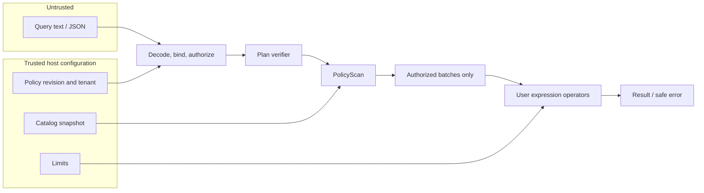
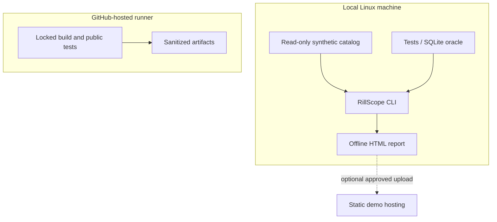
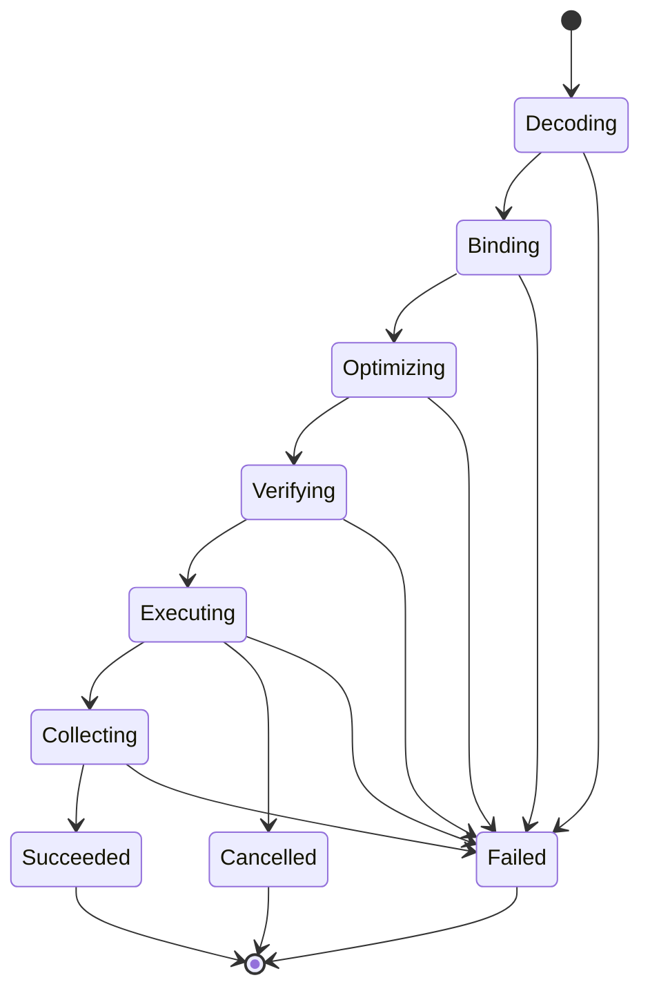

# RillScope architecture

## System context and ownership
A trusted operator/embedding host owns catalogs, policies and resource limits. An untrusted query client owns only query syntax. The host can already read all data; this library is not a barrier against that host or another process running as the same OS user. The core is a library and CLI, not a network service. No TLS/OAuth/session database is required because there is no remote authorization endpoint.



## Module and process boundaries
Workspace: `rillscope-core` owns data types, expression semantics, catalog and execution; `rillscope-plan` owns input IR, binding, optimizer and verifier; `rillscope-cli` owns JSON/SQL frontend, process entry and serialization. Keep core policy constructors private; avoid circular dependencies by putting shared bound-plan types in core with restricted constructors and a verifier module owned by plan. Exact final split may use one library crate with modules if Rust visibility would otherwise expose unsafe constructors; the three conceptual boundaries remain and no new service is implied. Initial implementation uses one `rillscope` crate with modules for simpler visibility.

`query.rs`: untrusted input types; `types.rs`: nullable values/schema IDs; `catalog.rs`: validated immutable tables; `bind.rs`: resolve/type/authorize; `plan.rs`: bound and physical nodes; `optimize.rs`: bounded deterministic rules; `verify.rs`: independently inspect leaf authority/schema/provenance; `execute.rs` and `operators/`: only VerifiedPlan execution; `budget.rs`: charged limits and cancellation; `error.rs`: closed error variants; CLI `main.rs`: operator-only file inputs and safe envelopes.



## Typed representations and provenance
Catalog schema assigns `(table_id,column_id)` identities, not user-controlled offsets. Input columns are qualified aliases/names, bound once. Each scan gets a unique source occurrence ID, table snapshot identity, tenant predicate derived from context and a visible-column set. A policy scan reads raw trusted columns internally, applies the tenant equality filter, then exposes only permitted column IDs to user expressions. Hidden tenant columns need not be user-visible.

Bound expressions carry `DataType` and nullability. Rows are bags, not sets. Types are nullable Int64, Boolean, UTF-8. Core column batches use owned primitive arrays plus validity bitmaps and bounded UTF-8 buffers; no Arrow wire-compatibility is claimed. Reusing a SQL parser and JSON serializer does not delegate binding, authorization, optimization or execution.

Only the verifier can construct `VerifiedPlan`, with private fields and no Deserialize implementation. An independent recursive traversal recomputes schema/provenance for each node, verifies all leaves are context-bound PolicyScan nodes, validates each reference/type, checks immutable context/snapshot identity and budgets, and ensures unsupported nodes cannot reach execution. It does not accept an optimizer-provided `safe: true` flag. The checker is not a theorem prover and still needs mutation/differential tests.

## Logical and physical operators
Input Scan -> bound PolicyScan. Filter keeps TRUE, discards FALSE/NULL. Project evaluates checked expressions. InnerHashJoin builds one side with duplicate-preserving key-to-row lists; NULL keys never match; cap build bytes and join output work before materializing expansion. Aggregate supports group keys, COUNT(*)/COUNT(expr)/SUM(Int64); checked overflow; grouping NULL is one key; scalar empty COUNT=0 and SUM=NULL. Sort is bounded stable comparison over visible columns with explicit null ordering; no locale collation. Limit is semantic and may safely stop after its requested count only when input ordering semantics allow it.

Batches default 1024 rows. Pull-based iterators return `Result<Option<Batch>>`. Filter/project stream; join build, aggregation and sort are pipeline breakers with explicit reservations. A result collector is also bounded and publishes one JSON response only after successful completion. It never labels a truncated result success.

## Optimizer rules and forbidden rewrites
Core rules: prune columns no ancestor requires (retain hidden policy dependencies internally); push a pure filter through project only after checked substitution with preserved types; push a filter referencing only one input toward that side of an INNER JOIN, but never below its PolicyScan boundary. No outer joins, effectful/volatile functions or exception-reordering arithmetic rewrites. Do not fold an expression if overflow/error behavior could change for rows otherwise filtered out. Constant TRUE filter removal is allowed; LIMIT cannot be pushed below a non-order-preserving aggregate/join merely for speed. Fixed order, maximum 16 passes and a structural convergence hash; nonconvergence is E_PLAN, not an infinite loop.

Because even error behavior can reveal hidden values, user arithmetic runs only after policy scans. No user expression is accepted inside the trusted tenant predicate. Independent reference tests compare optimization on/off and SQLite over physically authorized tables.

## Critical sequence
```mermaid
sequenceDiagram
  participant H as Trusted host
  participant F as Frontend
  participant B as Binder
  participant O as Optimizer
  participant V as Verifier
  participant E as Executor
  H->>F: fixed catalog/context + untrusted query
  F->>F: bytes/depth/nodes/version gate
  F->>B: unresolved plan
  B->>B: resolve types + deny forbidden references
  B->>O: policy-bound logical plan
  O->>V: candidate physical plan + identities
  V-->>E: opaque VerifiedPlan or error
  E->>E: policy scans before user expressions
  E->>E: charge work/memory; collect bounded result
  E-->>H: one complete typed result or error
```

## Trust boundaries and data flow


## Concurrency, consistency and lifecycle
No cross-query mutable state or plan cache in v1. One thread executes one plan; Arc-owned immutable catalog can be shared by trusted library hosts, but concurrent memory/global admission policy remains their responsibility. Cancellation is an AtomicBool and optional monotonic deadline checked at operator entry, each batch and every 1024 inner-loop steps. Memory reservations are acquired before growing owned operator buffers and released through RAII. Work charging includes scanned rows, comparisons/probes, aggregate updates and emitted cells; exact work-unit definitions are versioned, not marketed as CPU instructions. A failed allocation returns a typed error where supported; OS OOM kill is a separate process failure and cannot guarantee an error response.

CLI startup loads bounded trusted files, validates schema/context, binds query, runs, emits exactly one stdout JSON object and exits. Diagnostic stderr is safe and value-free by default. SIGTERM can request cooperative cancellation on Linux; integration must verify actual handler behavior. A hard kill terminates the process and leaves the read-only catalog untouched. No retries inside engine; a trusted caller may retry the same read-only snapshot query. No idempotency ledger is needed because queries have no external mutations. No circuit breaker or distributed queue is needed because there are no remote dependencies.

## Configuration, files, logs and compatibility
Catalog JSON v1 and trusted context JSON v1 are explicit operator paths. Query input accepts stdin or an operator-selected file; query expressions cannot name files. CLI `--context` is an operator capability and must never be exposed as an agent parameter. Environment variables only select output/evidence directories; there are no production secrets. Default logs: request-local ID, phase/error code, bounded duration/work/reservation counters, query digest only when explicitly requested. No raw query/result or unfiltered catalog statistics in default logs.

JSON schema major mismatches fail. A minor extension requires an explicit schema-version change or backward-compatible optional field accepted by a documented decoder version; unknown fields currently reject. Immutable catalogs need no migrations. Backup means preserving validated input files and their hashes; generated reports can be regenerated.

## Deployment


## Query state machine


## Removal test / architecture decisions
| Component | Requirement | Simpler alternative | Decision | Property lost if removed |
|---|---|---|---|---|
| Restricted frontend/binder | FR-001/002/003, SEC-002 | Pass SQL to SQLite | Reuse syntax parser, own binding | New compiler/type/auth signal and uniform contract |
| PolicyScan primitive | SEC-001 | Add optional WHERE string | Non-removable leaf with trusted scope | Enforcement independent of client query |
| Independent verifier | SEC-003 | Trust optimizer output | Recompute leaf/schema/provenance checks | Detect invalid physical plans before data use |
| Own batched operators | FR-004, PERF-001 | DuckDB execution wrapper | Original bounded operators | The main execution-engine signal |
| Typed error/budget layer | SEC-006, REL-002 | Let allocator/timeouts decide | Cooperative charges + explicit failures | Predictable finite rejection and diagnosis |
| SQLite oracle | FR-005/006 | Compare to copied implementation | Physically filtered independent relations | Independent semantic evidence |
| Static inspector | FR-007/008 | Logs only | Small escaped HTML generated from actual runs | Five-minute reviewability |
| Rust | NFR-002 | Python-only executor | Ownership/types, predictable layout and profiling | Systems implementation and memory accounting depth |

Removed: Kubernetes, Redis, Kafka, PostgreSQL service, auth server, web framework, LLM provider, custom cryptography, distributed scheduler, plan cache, JIT and commercial analytics. Their removal loses no required core property. See DECISIONS.md for revisiting conditions.
