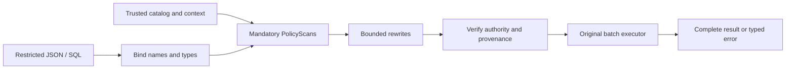

# RillScope

**An original Rust query compiler and bounded analytical executor.**

RillScope lets a client choose a restricted JSON or SQL query while a trusted host fixes which tenant and columns it may read. Binding, policy lowering, optimization and execution preserve that authority boundary.

The implementation includes typed NULLs, duplicate-preserving rows, hash joins, grouped aggregates, stable sorting, an opaque verified plan, logical resource accounting and cooperative cancellation. SQLite is an independent test oracle; it is not the execution engine.

This is experimental software. Recorded checks include 48 Rust tests, 814 reference tests, 1,000 property cases and 2,000 malformed-input cases. Full strict acceptance remains unestablished because current visual/keyboard inspection is unverified under the [AC-008 exception](TEST_SPEC_EXCEPTION_AC-008.md). Review shares implementation history. See [verification](VERIFICATION_REPORT.md) and [limits](LIMITATIONS.md).

## Run it

Prerequisites: Git, Make, Python 3.11+ with SQLite, and rustup. The project pins Rust 1.99.0.

```sh
git clone https://github.com/C-X1an/rillscope.git
cd rillscope
make bootstrap build
target/debug/rillscope run --catalog examples/catalog.json --context examples/context.json --query examples/query.json
target/debug/rillscope explain --catalog examples/catalog.json --context examples/context.json --query examples/query.json
make demo
```

The example returns three orders and total 40 for tenant alpha. Use `examples/forbidden.json` to observe `E_FORBIDDEN`; the beta context returns `[[1,999]]`. SQL uses `--format sql`, stdin uses `--query -`, and `--optimize off` disables rewrites. Windows executables have the `.exe` suffix.

Catalog/context paths are trusted operator inputs. The [fixed-scope adapter](tools/fixed_scope.py) accepts only query format/source and the output choice from an untrusted client. No model API, service account or cloud query endpoint is required.

## View the report

`make demo` runs the actual Rust CLI and compares independently materialized authorized SQLite relations. It prints the generated offline HTML path under ignored `.local-runs/`. A [recorded report](docs/demo/rust-report.html) and [historical screenshot](docs/demo/rust-desktop.jpg) are available for inspection. The historical capture does not qualify the current missing visual/keyboard acceptance record.

## Check and reproduce

```sh
make fmt lint check test
make verify-reference
make integration acceptance property fuzz security
make publication-check
```

The Python reference supports semantic comparison and does not prove Rust correctness. Malformed-input testing is finite seeded execution; libFuzzer has not run. The [CI workflow](.github/workflows/verify.yml) runs the public checks. `make verify` and `make clean-verify` include the guarded full reference-host recipe. `make release-verify` also requires current evidence for every locked criterion and continues to reject absent AC-008 evidence.

## Inspect the design



| Public interface | Implementation |
| --- | --- |
| Compiler and verified execution | [src/lib.rs](src/lib.rs), [src/verify.rs](src/verify.rs), [src/execute.rs](src/execute.rs) |
| Nullable columns and operators | [src/types.rs](src/types.rs), [src/operators](src/operators) |
| Formats and authority | [API](API_SPEC.md), [architecture](ARCHITECTURE.md), [threat model](THREAT_MODEL.md) |
| Required behavior | [acceptance contract](ACCEPTANCE_SPEC.md), [test matrix](TEST_MATRIX.md) |
| Recorded results and limitations | [verification](VERIFICATION_REPORT.md), [benchmarks](BENCHMARKS.md), [claims](CLAIMS_EVIDENCE.md) |
| Reproduction and contribution | [operations](OPERATIONS.md), [contributing](CONTRIBUTING.md) |

The public repository contains product source, tests, contracts, licenses, reproduction tools, essential documentation and current claim support. Development logs, retired captures and historical working material are kept privately. Historical identifiers in retained evidence describe their original executions; they are not claims that old GitHub run URLs remain public.

Original source is [MIT licensed](LICENSE). See [third-party notices](THIRD_PARTY_NOTICES.md) and [security guidance](SECURITY.md).
