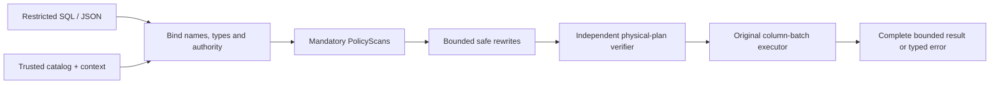

<div align="center">

# RillScope

### Make query authority part of the plan.

**A policy-aware query compiler and bounded execution-engine experiment.**

[Start](#run-the-reference) · [Architecture](ARCHITECTURE.md) · [Contracts](ACCEPTANCE_SPEC.md) · [Evidence](VERIFICATION_REPORT.md) · [Limits](LIMITATIONS.md)

**Development seed · MIT · No model API required**

</div>

---

A client should be able to ask a useful question without deciding which tenant data it may read. RillScope explores that boundary inside a small relational compiler: the host fixes authority, the query supplies intent, and the plan must preserve both semantics and scope.

> **Status:** The Python semantic reference and its tests are executable. The Rust kernel source is prepared but was not compiled in the authoring environment. The full Rust parser, binder, optimizer, general executor and independent plan verifier are **not finished**. Read [implementation status](IMPLEMENTATION_STATUS.md) before interpreting the architecture as delivered functionality.

## The experiment

| Bind the question | Preserve the boundary | Inspect the evidence |
|:--|:--|:--|
| A closed query language with explicit types, nullable values and duplicate-preserving rows. | Host-derived policy scans, all-position column checks and bounded execution. | Independent oracle comparisons, targeted negative controls and source-identified command receipts. |

This is **not a DuckDB wrapper**, a production database or a claim of faster query execution. The planned Rust engine owns binding, rewrites and operators. SQLite is a separate test oracle over physically authorized tables.

## Run the reference

You need **Python 3.11+**, its standard-library SQLite module, Git and Make. No account, API key, paid service or Python package install is required.

```sh
make verify-reference
make mutation-reference
make demo-reference
```

The demo prints a local `report.html` path under ignored `.local-runs/`. Open it to inspect three actual **Python-reference** executions: an authorized aggregate, a forbidden-column rejection and work-budget exhaustion. The HTML is escaped, script-free and offline; it is not a mock image of a completed Rust application.

Run one query directly:

```sh
python3 -m tools.reference.cli \
  --catalog examples/catalog.json \
  --context examples/context.json \
  --query examples/query.json
```

The synthetic alpha-tenant query returns **3 orders and a total of 40**. The beta-tenant amount is excluded. Change only the query to `examples/forbidden.json` to observe an `E_FORBIDDEN` error. Context and catalog paths are **trusted operator inputs**, not client-controlled parameters.

The recorded [reference report](docs/demo/reference-report.html) and [desktop capture](docs/demo/desktop.png) show the same executed example; they do not depict the unfinished Rust product.

## From query to result

**Target Rust architecture** — not all boxes are implemented yet:



| Area | Inspect |
|:--|:--|
| Nullable Rust columns, checked arithmetic and scoped scan seed | [`src/lib.rs`](src/lib.rs) |
| Executable semantic reference | [`tools/reference/engine.py`](tools/reference/engine.py) |
| SQL-like NULL, duplicate, tenant, binding and SQLite comparisons | [`tests/test_reference.py`](tests/test_reference.py) |
| Deliberately broken tenant/NULL/join controls | [`scripts/mutation_reference.py`](scripts/mutation_reference.py) |
| Command capture and output hash verification | [`scripts/evidence.py`](scripts/evidence.py) |
| Closed query and trusted catalog/context formats | [API contract](API_SPEC.md) |

## Build the Rust kernel

The intended toolchain is pinned to **Rust 1.99.0**. In an environment with rustup and permitted official toolchain access:

```sh
make bootstrap
make build fmt lint check test
```

These commands must actually succeed before making a Rust verification claim. `make format` applies rustfmt; `make fmt` checks it. The seed binary only exposes `seed-status`; it deliberately refuses to impersonate the unfinished query CLI.

## Evidence that stays honest

The reference suite includes a **1,000-seed SQLite comparison test** across filter/project, grouped aggregates, joins, scalar aggregates and ordering. Three targeted mutations exercise selected tenant, NULL and duplicate-handling defects. These counts describe **test design and recorded reference execution**, not coverage of all SQL, Rust validation, security certification or production users.

[Verification report](VERIFICATION_REPORT.md) separates what ran from what did not. [Claims-to-evidence](CLAIMS_EVIDENCE.md) keeps the full Rust acceptance claims pending. [Benchmark methodology](BENCHMARKS.md) distinguishes a tiny reference harness measurement from the unmeasured Rust performance targets.

`make verify` is the full product gate and currently fails while unfinished required gates remain. A green reference check or future source-only CI run must not be represented as full-product approval.

## Boundaries worth reading

A trusted host can already read the catalog. This design limits what a restricted query can return; it does not hide information from that host, provide timing/inference privacy, isolate malicious operating-system processes or solve model prompt injection. Logical work/memory accounting must not be confused with hard OS resource isolation.

The prototype deliberately excludes arbitrary SQL functions, native code generation, distributed execution, external auth services, plan caching and spill. [Threat model](THREAT_MODEL.md) and [limitations](LIMITATIONS.md) define the boundary precisely.

## Documentation

| Build and understand | Assess and reproduce |
|:--|:--|
| [Product scope](PRD.md) | [Locked acceptance criteria](ACCEPTANCE_SPEC.md) |
| [Architecture and decisions](ARCHITECTURE.md) | [Test matrix](TEST_MATRIX.md) |
| [API and data formats](API_SPEC.md) | [Evaluation strategy](EVALUATION.md) |
| [Operations](OPERATIONS.md) | [Verification report](VERIFICATION_REPORT.md) |
| [Dependencies](DEPENDENCIES.md) | [Claims and evidence](CLAIMS_EVIDENCE.md) |
| [Contributing](CONTRIBUTING.md) | [Security policy](SECURITY.md) |

Original source is [MIT licensed](LICENSE). See [third-party notices](THIRD_PARTY_NOTICES.md) for runtime/dependency and synthetic-data provenance.

---

<div align="center"><strong>A result is useful only when its authority and its evidence are clear.</strong></div>
