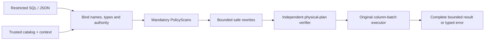

<div align="center">

# RillScope

### Make query authority part of the plan.

**A policy-aware query compiler and bounded execution-engine experiment.**

[Start](#run-the-reference) · [Architecture](ARCHITECTURE.md) · [Contracts](ACCEPTANCE_SPEC.md) · [Evidence](VERIFICATION_REPORT.md) · [Limits](LIMITATIONS.md)

**Experimental Rust engine · MIT · No model API required**

</div>

---

A client should be able to ask a useful question without deciding which tenant data it may read. RillScope explores that boundary inside a small relational compiler: the host fixes authority, the query supplies intent, and the plan must preserve both semantics and scope.

> **Status:** The original Rust JSON/SQL compiler, binder, policy verifier, optimizer and batch executor are implemented. Recorded checks include36 Rust unit tests,31 CLI/adapter/report tests,1000 scoped SQLite cases comparing JSON/SQL and optimization modes, and2000 malformed inputs. Independent inspections found defects that were reproduced, fixed and retested. The real Rust demo and fixed-scope adapter run locally. [e7f9426 Linux CI](https://github.com/C-X1an/rillscope/actions/runs/38944156500) passed all jobs; at[72f31071](https://github.com/C-X1an/rillscope/actions/runs/38958921426) reference, dependency and product jobs passed while the debugger experiment failed before Rust execution. Actual nullable-sort supplements retained4200 observations each. The complete Windows grid retained43050 observations and failed qualification on3 process timeouts; every record remains visible. Final cancellation-boundary review, qualifying complete-grid validation, complete fresh reproduction and dedicated reference-host measurements remain incomplete. This is an experimental development build. Read [implementation status](IMPLEMENTATION_STATUS.md) for evidence limits.

## The experiment

| Bind the question | Preserve the boundary | Inspect the evidence |
|:--|:--|:--|
| A closed query language with explicit types, nullable values and duplicate-preserving rows. | Host-derived policy scans, all-position column checks and bounded execution. | Independent oracle comparisons, targeted negative controls and source-identified command receipts. |

The Rust engine owns binding, rewrites and operators. SQLite is a separate test oracle over physically authorized tables. No production use or performance advantage is claimed.

## Run the Rust engine

```sh
make bootstrap build
target/debug/rillscope run --catalog examples/catalog.json --context examples/context.json --query examples/query.json
target/debug/rillscope explain --catalog examples/catalog.json --context examples/context.json --query examples/query.json
make integration property fuzz
make demo
```

The actual Rust example returns three orders and total 40. Use `examples/forbidden.json` for a typed denial. SQL input uses `--format sql`; stdin uses `--query -`; `--optimize off` disables rewrites. Catalog/context paths and synthetic [test hooks](TEST_HOOKS.md) are trusted host controls. An untrusted client receives only the restricted query interface.

`make demo` executes the Rust CLI through [the fixed-scope adapter](tools/fixed_scope.py) and independently materializes each tenant's authorized relation in SQLite. Open its generated offline report, or inspect [the recorded Rust report](docs/demo/rust-report.html), [actual screenshot](docs/demo/rust-desktop.jpg), and [visual/keyboard inspection](docs/demo/rust-visual-review.json). It shows alpha `[[3,40]]`, `E_FORBIDDEN`, and beta `[[1,999]]`. No model keys or cloud service are required. The adapter's client request contains only query format/source and output choice; its constructor's binary/catalog/context paths are trusted host configuration.

## Run the reference

You need **Python 3.11+**, its standard-library SQLite module, Git and Make. No account, API key, paid service or Python package install is required.

```sh
make verify-reference
make mutation-reference
make demo-reference
```

The demo prints a local `report.html` path under ignored `.local-runs/`. Open it to inspect three actual **Python-reference** executions: an authorized aggregate, a forbidden-column rejection and work-budget exhaustion. The HTML is escaped, script-free and offline; it is not a mock image of a completed Rust application.

Run one query directly:

```sh
python3 -m tools.reference.cli \
  --catalog examples/catalog.json \
  --context examples/context.json \
  --query examples/query.json
```

The synthetic alpha-tenant query returns **3 orders and a total of 40**. The beta-tenant amount is excluded. Change only the query to `examples/forbidden.json` to observe an `E_FORBIDDEN` error. Context and catalog paths are **trusted operator inputs**, not client-controlled parameters.

The recorded [reference report](docs/demo/reference-report.html) and [desktop capture](docs/demo/desktop.png) show the Python-reference example.

## From query to result

The implemented Rust pipeline is:



| Area | Inspect |
|:--|:--|
| Compiler entry point and opaque verified execution | [`src/lib.rs`](src/lib.rs), [`src/verify.rs`](src/verify.rs), [`src/execute.rs`](src/execute.rs) |
| Owned nullable columns and original operators | [`src/types.rs`](src/types.rs), [`src/operators/`](src/operators/) |
| Actual Rust CLI / SQLite and malformed-input checks | [`tests/acceptance_locked/`](tests/acceptance_locked/), [`tests/property/`](tests/property/), [`tests/security/`](tests/security/) |
| Executable semantic reference | [`tools/reference/engine.py`](tools/reference/engine.py) |
| SQL-like NULL, duplicate, tenant, binding and SQLite comparisons | [`tests/test_reference.py`](tests/test_reference.py) |
| Deliberately broken tenant/NULL/join controls | [`scripts/mutation_reference.py`](scripts/mutation_reference.py) |
| Command capture and output hash verification | [`scripts/evidence.py`](scripts/evidence.py) |
| Closed query and trusted catalog/context formats | [API contract](API_SPEC.md) |

## Build and check the Rust product

The intended toolchain is pinned to **Rust 1.99.0**. In an environment with rustup and permitted official toolchain access:

```sh
make bootstrap
make build fmt lint check test
```

These commands must actually succeed before making a Rust verification claim. `make format` applies rustfmt; `make fmt` checks it. The production binary exposes `run`, `explain` and `--version`; the original seed is retained only with its historical tests.

## Evidence that stays honest

The reference suite includes a **1,000-seed SQLite comparison test** across filter/project, grouped aggregates, joins, scalar aggregates and ordering. Three targeted mutations exercise selected tenant, NULL and duplicate-handling defects. These counts describe **test design and recorded reference execution**, not coverage of all SQL, Rust validation, security certification or production users.

[Verification report](VERIFICATION_REPORT.md) separates executed checks from outstanding requirements. [Claims-to-evidence](CLAIMS_EVIDENCE.md) records scoped Rust successes alongside failed, blocked and unmeasured criteria. [Benchmark methodology](BENCHMARKS.md) distinguishes reference smoke measurements, Rust instrumentation pilots and the pending complete/reference-host results.

`make verify` executes the full product validation sequence, including the reference-host benchmark and a fresh committed checkout. It currently fails while required runtime gates remain unavailable. Once its receipts have been collected into the public evidence index, `make release-verify` additionally requires current passing evidence for every locked criterion. This ordering lets a fresh run produce AC-024 evidence before the final claims audit consumes it. A green reference check or source-only CI run does not establish full-product approval.

## Boundaries worth reading

A trusted host can already read the catalog. This design limits what a restricted query can return; it does not hide information from that host, provide timing/inference privacy, isolate malicious operating-system processes or solve model prompt injection. Logical work/memory accounting must not be confused with hard OS resource isolation.

The prototype deliberately excludes arbitrary SQL functions, native code generation, distributed execution, external auth services, plan caching and spill. [Threat model](THREAT_MODEL.md) and [limitations](LIMITATIONS.md) define the boundary precisely.

## Documentation

| Build and understand | Assess and reproduce |
|:--|:--|
| [Product scope](PRD.md) | [Locked acceptance criteria](ACCEPTANCE_SPEC.md) |
| [Architecture and decisions](ARCHITECTURE.md) | [Test matrix](TEST_MATRIX.md) |
| [API and data formats](API_SPEC.md) | [Evaluation strategy](EVALUATION.md) |
| [Operations](OPERATIONS.md) | [Verification report](VERIFICATION_REPORT.md) |
| [Dependencies](DEPENDENCIES.md) | [Claims and evidence](CLAIMS_EVIDENCE.md) |
| [Contributing](CONTRIBUTING.md) | [Security policy](SECURITY.md) |

Original source is [MIT licensed](LICENSE). See [third-party notices](THIRD_PARTY_NOTICES.md) for runtime/dependency and synthetic-data provenance.

---

<div align="center"><strong>A result is useful only when its authority and its evidence are clear.</strong></div>
