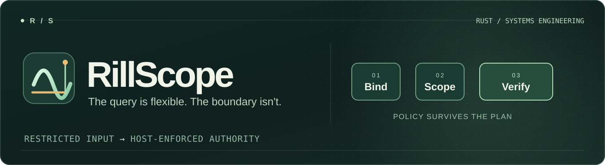
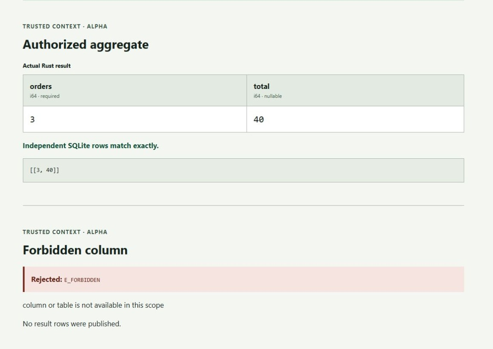
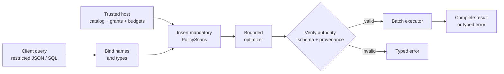

<div align="center">



# RillScope

**The query is flexible. The data boundary isn't.**

An experimental **Rust query compiler and bounded analytical executor** that accepts restricted JSON or SQL while keeping tenant access, permitted columns and execution limits under the trusted host's control.

[](rust-toolchain.toml)
[](LICENSE)
[](https://github.com/C-X1an/rillscope/actions/workflows/verify.yml)
[](LIMITATIONS.md)

**[Quickstart](#quickstart)** · **[Real execution](#watch-a-real-execution)** · **[Architecture](#how-it-works)** · **[Verification](#verification-and-honest-limits)** · **[Documentation](#documentation)**

</div>

---

## Why RillScope?

Handing a client a query interface shouldn't mean handing it authority over the database. RillScope separates **what a client can ask** from **what the host permits it to read**. The client supplies a bounded query; the host provides an immutable catalog, tenant context, column grants and resource budgets. The compiler then binds every reference, inserts mandatory policy scans, verifies the resulting plan and only then executes it.

| Query-engineering depth | Boundary by construction | Reproducible evidence |
| :--- | :--- | :--- |
| Typed nullable values, hash joins, grouped aggregates, stable sort, projection pruning and filter pushdown. | An opaque `VerifiedPlan`, authority/provenance checks, typed failures, logical reservations and cooperative cancellation. | Real Rust CLI executions compared with independently materialized authorized SQLite relations; tests and benchmark methodology are published. |

> [!NOTE]
> **Scope matters.** This is an experimental local system, not a hosted multi-tenant service or OS sandbox. Logical reservations are not process-memory limits. Strict release acceptance remains **unestablished** because current visual/keyboard inspection for [AC-008](TEST_SPEC_EXCEPTION_AC-008.md) is unverified.

## Watch a real execution

<a href="docs/demo/rust-report.html"></a>

<sub>Authentic crop of the [recorded Rust desktop capture](docs/demo/rust-desktop.jpg), not a mock-up or an illustration. Synthetic fixtures; original results are preserved. [Open the complete offline report](docs/demo/rust-report.html) · [Reproduce the run](docs/demo/README.md).</sub>

| Authorized | Denied | Tenant separation |
| :--- | :--- | :--- |
| **Alpha:** `orders = 3`, `total = 40` — independent SQLite rows match. | Querying a forbidden column returns **`E_FORBIDDEN`**; no result rows are published. | **Beta:** `orders = 1`, `total = 999` under a different trusted context. |

The report is generated from actual Rust CLI runs by `make demo`. Its saved image is a **historical** capture: it does not count as a new browser or keyboard-accessibility test, and the [AC-008 exception](TEST_SPEC_EXCEPTION_AC-008.md) remains open.

## Quickstart

**Requirements:** Git, Make, Python 3.11+ with SQLite, and `rustup` (the project pins **Rust 1.99.0**).

```sh
git clone https://github.com/C-X1an/rillscope.git
cd rillscope
make bootstrap build

# Execute, then inspect the compiler's plan.
target/debug/rillscope run --catalog examples/catalog.json --context examples/context.json --query examples/query.json
target/debug/rillscope explain --catalog examples/catalog.json --context examples/context.json --query examples/query.json

# Run the Rust/SQLite evidence demo; open the reported local HTML path.
make demo
```

The default query returns `orders = 3` and `total = 40` for tenant alpha. Try [`examples/forbidden.json`](examples/forbidden.json) to observe `E_FORBIDDEN`. Pass `--format sql` for restricted SQL, `--query -` for stdin or `--optimize off` to disable rewrites. On Windows the executable has a `.exe` suffix.

**Trusted vs. untrusted inputs:** The catalog/context files above are operator-controlled. The [fixed-scope adapter](tools/fixed_scope.py) limits client input to query text/format and output choice; the client cannot choose a tenant, catalog, grants or budgets. No LLM key, database service or cloud account is needed.

## How it works



The **policy boundary survives optimization**: rewrites cannot push a scan below `PolicyScan`; verification independently recomputes authority, schema and provenance before execution. The executor supports nullable columns, duplicate-preserving joins, aggregates, stable sorting, explicit row/byte/work limits and cancellation. SQLite is used only as a test oracle, **not** as the execution engine.

Explore the [architecture](ARCHITECTURE.md), [API contract](API_SPEC.md), [threat model](THREAT_MODEL.md) and [implementation status](IMPLEMENTATION_STATUS.md).

## Verification and honest limits

The published [verification report](VERIFICATION_REPORT.md) records real executions, including **48 Rust tests**, **814 reference/tooling tests**, **1,000 seeded property cases** and **2,000 seeded malformed-input cases**, plus integration, security-contract and selected mutation/transport controls. These are finite test results, not a general correctness or security guarantee.

```sh
make fmt lint check test
make verify-reference
make integration acceptance property fuzz security
make publication-check
```

The [CI workflow](.github/workflows/verify.yml) executes public checks. `make verify` runs a broader guarded verification sequence; `make clean-verify` reproduces it from a fresh committed checkout. **`make release-verify` intentionally rejects missing strict acceptance evidence** until AC-008 is genuinely satisfied. libFuzzer has not run; logical limits do not enforce an OS-level memory cap.

Read the [evidence matrix](CLAIMS_EVIDENCE.md), [benchmarks](BENCHMARKS.md), [locked acceptance criteria](ACCEPTANCE_SPEC.md) and [limitations](LIMITATIONS.md) before drawing performance or security conclusions.

## Documentation

| Start here | Go deeper |
| :--- | :--- |
| [**Run and inspect**](OPERATIONS.md) · [Demo guide](docs/demo/README.md) | [Compiler architecture](ARCHITECTURE.md) · [API and data contract](API_SPEC.md) |
| [**Verify behavior**](VERIFICATION_REPORT.md) · [Test matrix](TEST_MATRIX.md) | [Evaluation](EVALUATION.md) · [Benchmarks](BENCHMARKS.md) · [Evidence](CLAIMS_EVIDENCE.md) |
| [**Understand the guarantees**](LIMITATIONS.md) · [Security](SECURITY.md) | [Threat model](THREAT_MODEL.md) · [Acceptance contract](ACCEPTANCE_SPEC.md) |
| [**Contribute**](CONTRIBUTING.md) · [Implementation status](IMPLEMENTATION_STATUS.md) | [Design decisions](DECISIONS.md) · [Dependencies](DEPENDENCIES.md) |

Built with original Rust engine code and a Python/SQLite reference test harness. Public artifacts use synthetic data; private development records are not part of this release. Historical evidence identifiers are provenance, not guarantees that retired run URLs remain publicly accessible.

<div align="center">

**[MIT License](LICENSE)** · **[Third-party notices](THIRD_PARTY_NOTICES.md)** · **[Security reporting](SECURITY.md)**

</div>
