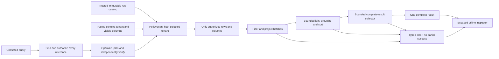

# Data flow: authority before user expressions

This companion diagram expands the combined trust/data-flow view in the locked architecture. It adds no new module or requirement. It describes the target Rust design, not delivered reference memory-accounting behavior.

Policy columns may be read internally by the trusted scan while remaining unavailable to user expressions. Binding checks columns in projections, predicates, join keys, aggregates and sort keys. The plan verifier is structural defense-in-depth; it is not a theorem prover. Work reservations and the final collector must reject exhaustion without publishing a partial successful result. Trusted host data, timing and aggregate-inference privacy remain outside the claimed boundary.
